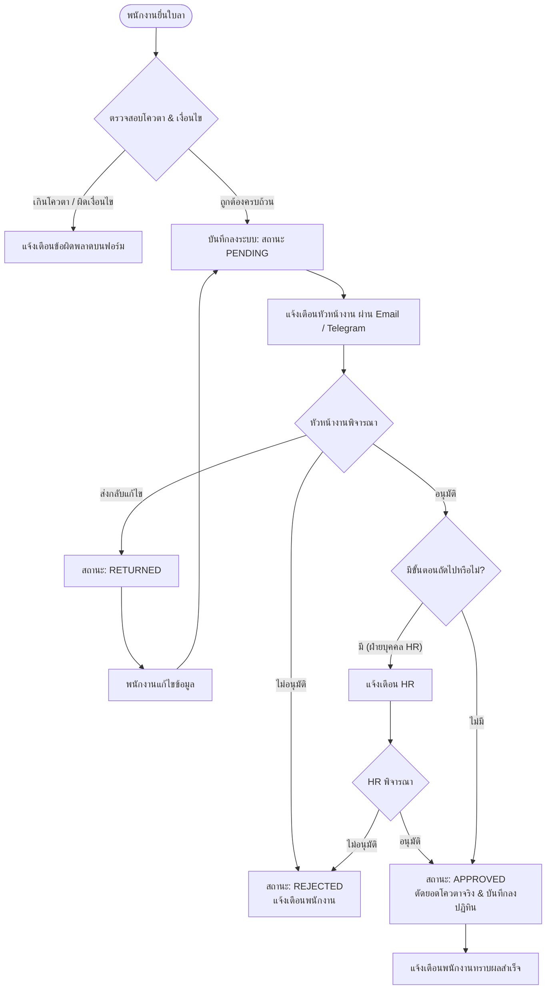

# 📗 คู่มือการใช้งานระบบลาออนไลน์ eLeave+ (User Manual)
### ระบบบริหารจัดการการลาออนไลน์ระดับองค์กรบน Google Workspace 100% Serverless

---

## 📋 สารบัญ
1. [บทบาทและสิทธิ์การใช้งาน (Roles & Permissions)](#1-บทบาทและสิทธิ์การใช้งาน-roles--permissions)
2. [การเข้าสู่ระบบและการใช้งานเบื้องต้น (Login & Basics)](#2-การเข้าสู่ระบบและการใช้งานเบื้องต้น-login--basics)
3. [คู่มือสำหรับพนักงาน (Employee Guide)](#3-คู่มือสำหรับพนักงาน-employee-guide)
   - [3.1 แดชบอร์ดภาพรวมและตรวจสอบสิทธิ์วันลาคงเหลือ](#31-แดชบอร์ดภาพรวมและตรวจสอบสิทธิ์วันลาคงเหลือ)
   - [3.2 ขั้นตอนการยื่นใบลาใหม่ (New Leave Request)](#32-ขั้นตอนการยื่นใบลาใหม่-new-leave-request)
   - [3.3 การแนบเอกสารประกอบ (ใบรับรองแพทย์ / เอกสารราชการ)](#33-การแนบเอกสารประกอบ-ใบรับรองแพทย์--เอกสารราชการ)
   - [3.4 การตรวจสอบสถานะและประวัติการลา](#34-การตรวจสอบสถานะและประวัติการลา)
   - [3.5 การแก้ไขใบลาที่ถูกส่งกลับ (Edit Returned Request)](#35-การแก้ไขใบลาที่ถูกส่งกลับ-edit-returned-request)
   - [3.6 การขอยกเลิกใบลา (Cancel Request)](#36-การขอยกเลิกใบลา-cancel-request)
   - [3.7 การใช้งานปฏิทินการลา (Leave Calendar)](#37-การใช้งานปฏิทินการลา-leave-calendar)
4. [คู่มือสำหรับผู้อนุมัติ / หัวหน้างาน (Approver Guide)](#4-คู่มือสำหรับผู้อนุมัติ--หัวหน้างาน-approver-guide)
   - [4.1 การตรวจสอบรายการรออนุมัติ (Pending Approvals)](#41-การตรวจสอบรายการรออนุมัติ-pending-approvals)
   - [4.2 การพิจารณา: อนุมัติ, ปฏิเสธ หรือส่งกลับเพื่อแก้ไข](#42-การพิจารณา-อนุมัติ-ปฏิเสธ-หรือส่งกลับเพื่อแก้ไข)
5. [คู่มือสำหรับฝ่ายบุคคล (HR Guide)](#5-คู่มือสำหรับฝ่ายบุคคล-hr-guide)
   - [5.1 การอนุมัติในขั้นตอนฝ่ายบุคคล (Final Approval)](#51-การอนุมัติในขั้นตอนฝ่ายบุคคล-final-approval)
   - [5.2 ตารางสรุปสิทธิ์วันลาทั้งองค์กร (Leave Balance Matrix)](#52-ตารางสรุปสิทธิ์วันลาทั้งองค์กร-leave-balance-matrix)
   - [5.3 การส่งออกรายงานเป็นไฟล์ Excel / CSV](#53-การส่งออกรายงานเป็นไฟล์-excel--csv)
   - [5.4 ปฏิทินภาพรวมการลาของบริษัท](#54-ปฏิทินภาพรวมการลาของบริษัท)
6. [คู่มือสำหรับผู้ดูแลระบบ (Admin Guide)](#6-คู่มือสำหรับผู้ดูแลระบบ-admin-guide)
   - [6.1 การจัดการข้อมูลพนักงาน (Users Management)](#61-การจัดการข้อมูลพนักงาน-users-management)
   - [6.2 การจัดการแผนก / ฝ่ายงาน (Departments)](#62-การจัดการแผนก--ฝ่ายงาน-departments)
   - [6.3 การจัดการประเภทการลาและโควตา (Leave Types & Quotas)](#63-การจัดการประเภทการลาและโควตา-leave-types--quotas)
   - [6.4 การกำหนดสายการอนุมัติ (Approval Steps & Flow)](#64-การกำหนดสายการอนุมัติ-approval-steps--flow)
   - [6.5 การจัดการปฏิทินวันหยุดประจำปี (Holidays)](#65-การจัดการปฏิทินวันหยุดประจำปี-holidays)
   - [6.6 การตั้งค่าระบบทั่วไป (System Configuration)](#66-การตั้งค่าระบบทั่วไป-system-configuration)
7. [ผังกระบวนการทำงานของระบบ (Workflow Diagram)](#7-ผังกระบวนการทำงานของระบบ-workflow-diagram)

---

## 1. บทบาทและสิทธิ์การใช้งาน (Roles & Permissions)

ระบบ **eLeave+** แบ่งระดับสิทธิ์การใช้งานออกเป็น 4 บทบาทหลัก เพื่อความปลอดภัยและความถูกต้องตามโครงสร้างองค์กร:

| บทบาท (Role) | สัญลักษณ์ | คำอธิบายสิทธิ์และหน้าที่ |
|---|:---:|---|
| **EMPLOYEE** | 👤 | **พนักงานทั่วไป:** ยื่นใบลา, ดูโควตาวันลาคงเหลือของตนเอง, ดูประวัติการลา, แก้ไข/ยกเลิกใบลา, ดูปฏิทินการลา |
| **APPROVER** | 👔 | **หัวหน้างาน/ผู้อนุมัติ:** มีสิทธิ์ของพนักงาน + ได้รับสิทธิ์พิจารณาอนุมัติ/ปฏิเสธ/ส่งกลับใบลาของพนักงานในแผนกตนเอง |
| **HR** | 📋 | **เจ้าหน้าที่ฝ่ายบุคคล:** มีสิทธิ์ของพนักงาน + พิจารณาอนุมัติขั้นสุดท้าย, ดูสถิติและโควตาวันลาของพนักงานทั้งบริษัท, ส่งออกรายงาน (Export CSV) |
| **ADMIN** | ⚙️ | **ผู้ดูแลระบบสูงสุด:** มีสิทธิ์ครอบคลุมทั้งหมด + จัดการข้อมูลพนักงาน, แผนก, ประเภทการลา, สายอนุมัติ, วันหยุด และตั้งค่าระบบ |

---

## 2. การเข้าสู่ระบบและการใช้งานเบื้องต้น (Login & Basics)

### 2.1 การเข้าสู่ระบบ (Login)
1. เปิดลิงก์ **Web App URL** บนเว็บเบราว์เซอร์ (รองรับทั้งมือถือ แท็บเล็ต และคอมพิวเตอร์)
2. กรอก **ชื่อผู้ใช้ (Username)** หรือ **อีเมล (Email)** ของท่าน
3. กรอก **รหัสผ่าน (Password)**
4. คลิกปุ่ม **"เข้าสู่ระบบ" (Sign In)**

> 💡 **หมายเหตุ:** หากระบบแจ้งเตือนว่า *"ต้องเปลี่ยนรหัสผ่านในการเข้าใช้งานครั้งแรก"* ระบบจะแสดงหน้าต่างให้กำหนดรหัสผ่านใหม่ทันทีก่อนเริ่มใช้งาน

### 2.2 การเปลี่ยนรหัสผ่านส่วนตัว (Change Password)
1. คลิกที่ชื่อผู้ใช้หรือไอคอนโปรไฟล์ที่มุมขวาบนของหน้าจอ
2. เลือกเมนู **"เปลี่ยนรหัสผ่าน"**
3. กรอกรหัสผ่านเดิม และระบุรหัสผ่านใหม่ที่ต้องการ (ความยาวไม่น้อยกว่า 6 ตัวอักษร)
4. คลิก **"บันทึกรหัสผ่านใหม่"**

### 2.3 การออกจากระบบ (Logout)
- คลิกที่ปุ่ม **"ออกจากระบบ"** ที่แถบเมนูด้านซ้ายหรือเมนูโปรไฟล์มุมบนขวา เซสชันจะถูกเพิกถอนทันทีเพื่อความปลอดภัย

---

## 3. คู่มือสำหรับพนักงาน (Employee Guide)

### 3.1 แดชบอร์ดภาพรวมและตรวจสอบสิทธิ์วันลาคงเหลือ
เมื่อเข้าสู่ระบบ หน้าแรกที่จะพบคือ **Dashboard**:
- **การ์ดสรุปสิทธิ์วันลา (Leave Balance Cards):** แสดงโควตาทั้งหมด, วันที่ใช้ไปแล้ว, วันที่รออนุมัติ, และวันที่คงเหลือของแต่ละประเภทการลา (เช่น ลาป่วย 30 วัน, ลาพักผ่อน 10 วัน, ลากิจ 10 วัน)
- **สถิติภาพรวม:** แสดงจำนวนวันที่ลาสะสมในปีงบประมาณปัจจุบัน
- **ใครลาบ้างวันนี้ (Who's on leave today):** รายชื่อเพื่อนร่วมงานที่ลาในวันนี้ ช่วยในการวางแผนประสานงาน

---

### 3.2 ขั้นตอนการยื่นใบลาใหม่ (New Leave Request)
1. คลิกที่เมนู **"ยื่นใบลา" (New Request)** ที่แถบเมนูด้านซ้าย หรือคลิกปุ่ม **"+ ยื่นใบลาใหม่"** บนหน้าแดชบอร์ด
2. กรอกข้อมูลในแบบฟอร์มการลา:
   - **ประเภทการลา (Leave Type):** เลือกลาป่วย, ลากิจ, ลาพักผ่อนประจำปี, ลาคลอด ฯลฯ
   - **วันที่เริ่มต้น (Start Date):** ระบุวันที่เริ่มลา
   - **ช่วงเวลาเริ่มต้น (Start Period):**
     - `เต็มวัน` (คิด 1.0 วัน)
     - `ครึ่งวันเช้า` (คิด 0.5 วัน)
     - `ครึ่งวันบ่าย` (คิด 0.5 วัน)
   - **วันที่สิ้นสุด (End Date):** ระบุวันสุดท้ายที่ลา
   - **ช่วงเวลาสิ้นสุด (End Period):** เลือกช่วงเวลาของวันสิ้นสุด
   - **เหตุผลการลา (Reason):** ระบุเหตุผลหรือความจำเป็น
   - **ข้อมูลติดต่อ / ผู้ปฏิบัติงานแทน (Contact Info):** เบอร์โทรศัพท์ที่ติดต่อได้ หรือชื่อเพื่อนร่วมงานที่ฝากงาน
3. **ระบบคำนวณวันลาสุทธิอัตโนมัติ:** ระบบจะคำนวณจำนวนวันลาจริง โดย **ไม่นับวันเสาร์-อาทิตย์ และวันหยุดนักขัตฤกษ์** ให้โดยอัตโนมัติ
4. ตรวจสอบข้อมูลให้ถูกต้อง แล้วคลิกปุ่ม **"ส่งคำขอลา" (Submit Request)**

---

### 3.3 การแนบเอกสารประกอบ (ใบรับรองแพทย์ / เอกสารราชการ)
- **เงื่อนไขอัตโนมัติ:** หากประเภทการลามีเงื่อนไขบังคับแนบเอกสาร (เช่น *ลาป่วยตั้งแต่ 3 วันขึ้นไป*) ระบบจะแสดงช่องแนบไฟล์พร้อมเครื่องหมายดอกจันสีแดง `*`
- **ประเภทไฟล์ที่รองรับ:** PDF, JPG, JPEG, PNG
- **ขนาดไฟล์:** ไม่เกิน 5 MB ต่อไฟล์
- ไฟล์จะถูกจัดเก็บลงใน Google Drive ขององค์กรอย่างปลอดภัย พร้อมสร้างลิงก์สำหรับให้ผู้บังคับบัญชาเปิดตรวจดูได้ทันที

---

### 3.4 การตรวจสอบสถานะและประวัติการลา
คลิกเมนู **"ประวัติการลา" (My Requests)** เพื่อดูรายการใบลาทั้งหมดของตนเอง โดยสถานะจะแบ่งตามสีชัดเจน:
- 🟡 **รอการอนุมัติ (PENDING):** ใบลาอยู่ในระหว่างรอหัวหน้างานหรือฝ่ายบุคคลพิจารณา
- 🟢 **อนุมัติแล้ว (APPROVED):** ใบลาผ่านการอนุมัติครบทุกขั้นตอนแล้ว (ระบบจะตัดยอดโควตาวันลาจริง)
- 🔴 **ปฏิเสธ (REJECTED):** คำขอไม่ได้รับการอนุมัติ (สามารถคลิกดูเหตุผลที่ถูกปฏิเสธได้)
- 🔵 **ส่งกลับเพื่อแก้ไข (RETURNED):** ผู้มีอำนาจส่งใบลาคืนมาเพื่อให้แก้ไขข้อมูลหรือแนบเอกสารเพิ่มเติม
- ⚪ **ยกเลิก (CANCELLED):** ใบลาที่พนักงานขอยกเลิก

---

### 3.5 การแก้ไขใบลาที่ถูกส่งกลับ (Edit Returned Request)
1. หากใบลาขึ้นสถานะ **"ส่งกลับเพื่อแก้ไข" (RETURNED)** จะมีปุ่ม **"แก้ไข"** ปรากฏขึ้น
2. คลิกปุ่ม **"แก้ไข"** เพื่อเปิดแบบฟอร์มเดิม
3. อ่านบันทึกข้อความจากผู้อนุมัติ (Decision Note) ว่าต้องการให้ปรับปรุงเรื่องใด (เช่น แนบใบรับรองแพทย์เพิ่ม หรือแก้ไขวันที่)
4. อัปเดตข้อมูลหรือแนบไฟล์ใหม่ แล้วกด **"ส่งคำขออีกครั้ง"** ใบลาจะถูกส่งกลับเข้าสายอนุมัติทันที

---

### 3.6 การขอยกเลิกใบลา (Cancel Request)
- สำหรับใบลาที่อยู่ในสถานะ **"รอการอนุมัติ" (PENDING)** พนักงานสามารถกดปุ่ม **"ยกเลิกคำขอ"** ได้ด้วยตนเองทันที
- ระบบจะปรับสถานะเป็น `CANCELLED` และคืนสิทธิ์วันลาที่รออนุมัติกลับเข้าโควตาทันที

---

### 3.7 การใช้งานปฏิทินการลา (Leave Calendar)
คลิกเมนู **"ปฏิทินการลา" (Calendar)**:
- แสดงปฏิทินรายเดือน แสดงแถบสีตามประเภทการลาของตนเองและเพื่อนร่วมงาน
- คลิกที่แถบสีบนปฏิทินเพื่อดูรายละเอียดว่าใครลา วันที่เท่าใด และลาประเภทใด
- มีตัวกรองให้เลือกดูเฉพาะแผนกตนเอง หรือดูภาพรวมทั้งองค์กร

---

## 4. คู่มือสำหรับผู้อนุมัติ / หัวหน้างาน (Approver Guide)

### 4.1 การตรวจสอบรายการรออนุมัติ (Pending Approvals)
เมื่อมีพนักงานในแผนกยื่นใบลา:
1. ระบบจะส่งอีเมลแจ้งเตือน หรือข้อความ Telegram แจ้งเตือนมายังหัวหน้างาน
2. เข้าสู่ระบบ eLeave+ จะพบตัวเลขแจ้งเตือนสีแดงที่เมนู **"รอการอนุมัติ" (Approvals)**
3. คลิกเข้าไปจะพบรายการคำขอลาของพนักงานในแผนกที่รอการพิจารณา

### 4.2 การพิจารณา: อนุมัติ, ปฏิเสธ หรือส่งกลับเพื่อแก้ไข
คลิกที่รายการใบลาเพื่อดูรายละเอียดเชิงลึก:
- ตรวจสอบชื่อพนักงาน, ตำแหน่ง, ประเภทการลา, วันที่ลา, จำนวนวันสุทธิ
- คลิกดู **ไฟล์แนบ (ใบรับรองแพทย์ / เอกสาร)** หากมี
- ตรวจสอบประวัติการลาที่ผ่านมาและโควตาคงเหลือของพนักงาน
- **เลือกดำเนินการ 1 ใน 3 รูปแบบ:**
  1. **อนุมัติ (Approve):** กดปุ่มสีเขียว เพื่ออนุมัติใบลา หากมีขั้นตอนถัดไป (เช่น HR) ใบลาจะถูกส่งต่อไปยังฝ่ายบุคคลทันที
  2. **ปฏิเสธ (Reject):** กดปุ่มสีแดง ระบุเหตุผลที่ไม่สามารถให้ลาได้ (เช่น ติดภารกิจเร่งด่วน หรือส่งงานไม่ทัน)
  3. **ส่งกลับเพื่อแก้ไข (Return for edit):** กดปุ่มสีส้ม ระบุหมายเหตุให้พนักงานแก้ไข (เช่น ขอให้อัปโหลดใบรับรองแพทย์ที่ชัดเจนกว่านี้)

---

## 5. คู่มือสำหรับฝ่ายบุคคล (HR Guide)

### 5.1 การอนุมัติในขั้นตอนฝ่ายบุคคล (Final Approval)
- สำหรับองค์กรที่กำหนดสายอนุมัติ 2 ขั้นตอน (หัวหน้าฝ่าย -> ฝ่ายบุคคล):
- เมื่อหัวหน้าฝ่ายอนุมัติแล้ว คำขอจะถูกส่งมายังกล่องงานของ **HR**
- เจ้าหน้าที่ HR ตรวจสอบความถูกต้องตามระเบียบบริษัท และกด **อนุมัติ (Approve)** เพื่อเสร็จสิ้นกระบวนการ

### 5.2 ตารางสรุปสิทธิ์วันลาทั้งองค์กร (Leave Balance Matrix)
คลิกเมนู **"รายงานการลา" (Reports / Balance Matrix)**:
- แสดงตารางสรุปสิทธิ์วันลาของพนักงานทุกคนทุกแผนกในหน้าจอเดียว
- แสดงสิทธิ์โควตาทั้งหมด, วันที่ใช้จริง, วันที่รออนุมัติ, และวันคงเหลือ แยกตามแต่ละประเภทการลา
- มีตัวกรองค้นหาตาม **แผนก**, **ปีงบประมาณ**, หรือค้นหาตาม **ชื่อพนักงาน**

### 5.3 การส่งออกรายงานเป็นไฟล์ Excel / CSV
- ในหน้ารายงาน คลิกปุ่ม **"Export CSV"**
- ระบบจะสร้างไฟล์ CSV พร้อม UTF-8 BOM ที่สามารถเปิดใช้งานบน **Microsoft Excel** ได้ทันทีโดยภาษาไทยไม่เป็นภาษาต่างดาว เพื่อนำไปใช้คำนวณเงินเดือน (Payroll) หรือสรุปผลงานประจำปี

---

## 6. คู่มือสำหรับผู้ดูแลระบบ (Admin Guide)

ผู้ใช้งานที่มีบทบาท **ADMIN** จะมองเห็นเมนู **"การตั้งค่าระบบ" (System Settings)** ที่แถบเมนูด้านซ้าย:

### 6.1 การจัดการข้อมูลพนักงาน (Users Management)
- **เพิ่มพนักงานใหม่:** คลิกปุ่ม **"+ เพิ่มพนักงาน"** กรอก Username, Email, ชื่อ-สกุล, แผนก, ตำแหน่ง, บทบาท (Role), และวันเริ่มงาน
- **เปิด/ระงับการใช้งานบัญชี:** คลิกที่ **Toggle Switch** สีเขียว/เทา ในตาราง เพื่อระงับบัญชีพนักงานที่ลาออกได้ทันที
- **รีเซ็ตรหัสผ่าน:** คลิกปุ่ม **"🔑 รีเซ็ต"** เพื่อตั้งรหัสผ่านใหม่ให้พนักงานที่ลืมรหัสผ่าน
- **แก้ไขข้อมูลส่วนตัว:** ปรับเปลี่ยนบทบาท แผนก หรือเบอร์โทรศัพท์

### 6.2 การจัดการแผนก / ฝ่ายงาน (Departments)
- เพิ่ม แก้ไข หรือลบรายชื่อแผนก/ฝ่ายงานในองค์กร
- สลับสถานะเปิด/ปิดใช้งานแผนกด้วย Toggle Switch

### 6.3 การจัดการประเภทการลาและโควตา (Leave Types & Quotas)
- ปรับเปลี่ยนโควตาวันลาประจำปี (เช่น ลาพักผ่อน 10 วัน, ลาป่วย 30 วัน)
- กำหนดเงื่อนไขบังคับแนบเอกสาร (เช่น ลาติดต่อกันกี่วันขึ้นไป)
- กำหนดสิทธิ์การยื่นลาย้อนหลัง (เปิด/ปิดด้วย Toggle Switch)
- เลือกสีประจำประเภทการลาสำหรับแสดงผลบนปฏิทิน

### 6.4 การกำหนดสายการอนุมัติ (Approval Steps & Flow)
- กำหนดลำดับขั้นการอนุมัติใบลาอย่างอิสระ เช่น:
  - **ลำดับที่ 1:** `APPROVER` (ขอบเขต: `SAME` แผนกเดียวกัน)
  - **ลำดับที่ 2:** `HR` (ขอบเขต: `*` ทุกแผนก)
- สามารถเพิ่มเป็น 3 ระดับ (เช่น หัวหน้าแผนก -> ผู้จัดการฝ่าย -> HR) ได้ตามโครงสร้างของแต่ละองค์กร

### 6.5 การจัดการปฏิทินวันหยุดประจำปี (Holidays)
- เพิ่ม/แก้ไข วันหยุดนักขัตฤกษ์ และวันหยุดพิเศษประจำปีของบริษัท
- วันหยุดที่ระบุในเมนูนี้ ระบบจะไม่นับเป็นวันลาของพนักงานโดยอัตโนมัติ

### 6.6 การตั้งค่าระบบทั่วไป (System Configuration)
- **ชื่อบริษัท / องค์กร**
- **รอบปีงบประมาณ (Fiscal Year):** เดือนเริ่มต้นสิทธิ์วันลา (1 = มกราคม, 10 = ตุลาคม)
- **วันหยุดประจำสัปดาห์:** กำหนดวันเสาร์-อาทิตย์เป็นวันหยุด (ไม่นับเป็นวันลา)
- **การแจ้งเตือน:** เปิด/ปิดการส่งอีเมลผ่าน Gmail และการแจ้งเตือนผ่าน Telegram Bot
- **การจำกัดขนาดไฟล์แนบ:** กำหนดขนาดสูงสุด (ค่าเริ่มต้น 5 MB)

---

## 7. ผังกระบวนการทำงานของระบบ (Workflow Diagram)

---
**eLeave+** © 2026 ระบบบริหารจัดการการลาออนไลน์ระดับองค์กร  
พัฒนาด้วย Google Apps Script, Tailwind CSS & Google Workspace
